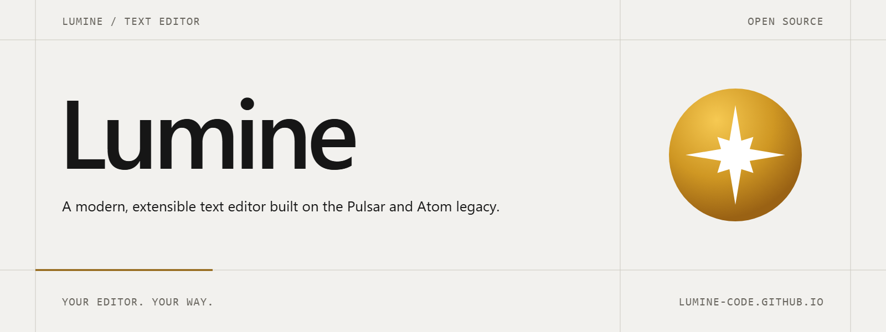
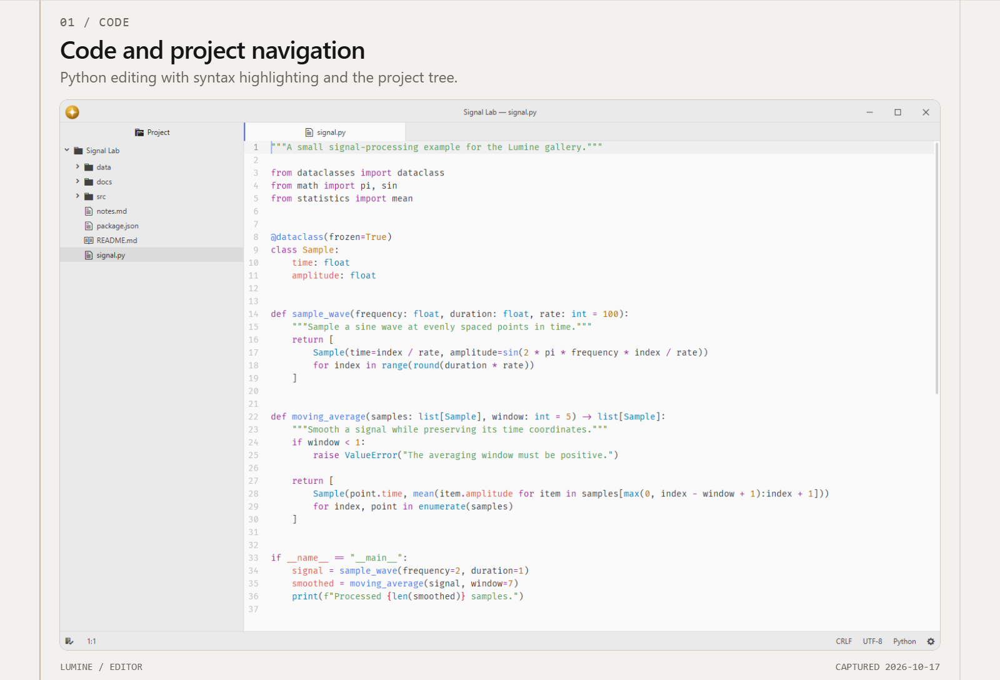
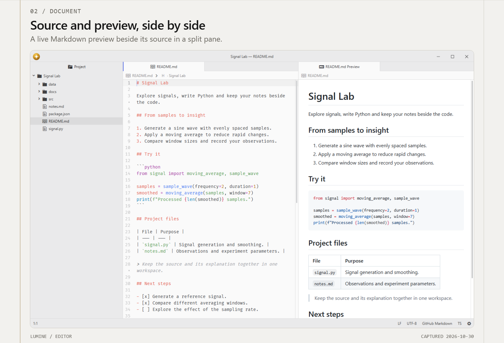
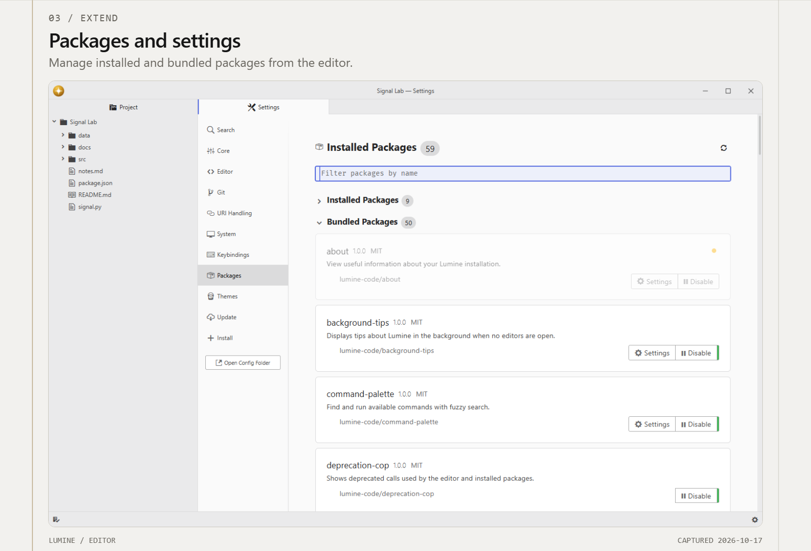
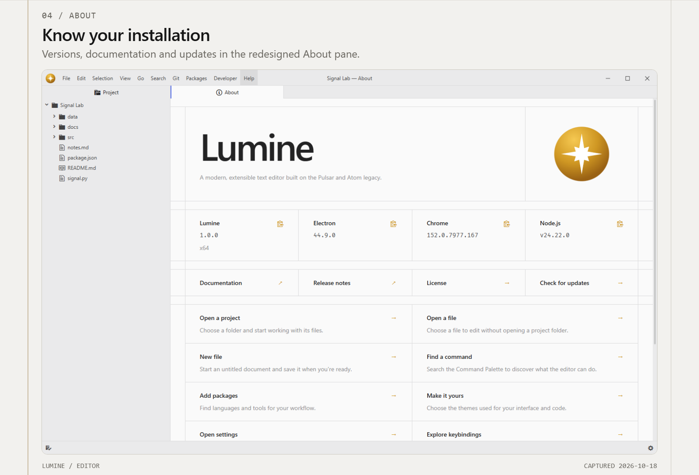

# Lumine **WIP**

A modern, extensible text editor built on the Pulsar and Atom legacy.

Website: https://lumine-code.github.io

Fork of [pulsar-edit/pulsar](https://github.com/pulsar-edit/pulsar) and [atom/atom](https://github.com/atom/atom).

## Features

- **Tree-sitter grammars**: real, incremental syntax parsing for dozens of bundled languages, from JavaScript and Python to Rust and Go.
- **Language intelligence**: semantic highlighting, inlay hints, and autocomplete through a built-in Language Server Protocol client.
- **Git integration**: branch and working-tree status in the status bar, with added, edited, and deleted markers in the gutter.
- **Symbol navigation**: jump to a function, method, or symbol in the current file or across the whole project.
- **Project navigation**: a tree view, fuzzy file finder, and project-wide search and replace.
- **A built-in package manager**: browse, install, and update packages and themes without leaving the editor.
- **A rich Jupyter ecosystem**: notebooks, kernels, and a REPL, all available as installable packages.
- **Deep hackability**: every keybinding, menu, theme, and behavior is overridable, and the whole UI is just JavaScript and CSS.
- **Cross-platform**: builds and runs on Windows, macOS, and Linux.
- ... and many more!

<picture>
  <source media="(prefers-color-scheme: dark)" srcset="resources/brand/banner-dark.png">
  
</picture>

<picture>
  <source media="(prefers-color-scheme: dark)" srcset=".github/gallery/01-dark.png">
  
</picture>

<picture>
  <source media="(prefers-color-scheme: dark)" srcset=".github/gallery/02-dark.png">
  
</picture>

<picture>
  <source media="(prefers-color-scheme: dark)" srcset=".github/gallery/03-dark.png">
  
</picture>

<picture>
  <source media="(prefers-color-scheme: dark)" srcset=".github/gallery/04-dark.png">
  
</picture>

## Contributing

Got ideas to make this package better, found a bug, or want to help add new features? Just drop your thoughts on GitHub. Any feedback is welcome!
