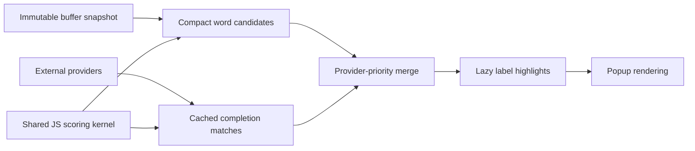

# Completion matching and buffer ownership

Completion matching uses one JavaScript scoring kernel in `src/completion-matcher.js`. Buffer-word search and autocomplete consume it through different APIs: storage searches immutable text; the completion model owns candidate matching and reuse; the view requests highlight indices for the displayed label. The generic native `lumine.tools.fuzzyMatcher` remains available for other search surfaces and is not called by autocomplete's ranking or highlighting path.

## Responsibilities

`TextBuffer.findWordCandidates(query, options)` returns at most `maxCount` distinct words from a clipped range. Every result includes `word`, `score`, `matchIndices`, its first absolute UTF-16 `position`, `occurrences`, nearest row `distance`, and `containsPosition`. It does not allocate an array containing every occurrence. `position` in the options supplies the cursor used for distance and containment; containment includes the end of the word. Without a cursor, distance is `Infinity`. Words and queries are limited to 80 UTF-16 units; additional word characters cannot include CR or LF. An aborted `signal` resolves to an empty list. The older subsequence APIs retain their existing result shape and relative range coordinates.

`lumine.tools.completionMatcher.createQuery(prefix)` prepares a synchronous query. `match(text)` returns `null` or an immutable match with `score` and lazy, immutable `matchIndices`. `isRefinementOf(previousPrefix)` checks both the original prefix and its case-folded representation. Folding preserves UTF-16 indices and equates Greek final and ordinary sigma, so a partial Greek word does not disappear merely because lowercasing changed its final letter. Queries longer than 256 UTF-16 units have no matches. Each query caches at most 2048 candidate strings, with a total limit of 262144 UTF-16 units; autocomplete retains eight recent queries per owner.

`autocomplete/lib/completion-matches.js` owns per-suggestion match records in a WeakMap. It validates prefix and match text before reuse, skips previously rejected candidates only for a compatible extension, and recomputes when the query shrinks or candidate text changes. The query cache can also reuse results across newly created suggestion objects with identical text. `filterText` supplies the ranking text; a different display label is matched lazily when visible. Explicit provider highlight indices remain authoritative. The renderer passes the whole suggestion to this model instead of independently invoking a native matcher.

The built-in word provider already returned ranked candidates and highlight indices before this change; it was not being ranked through native fuzzy matching a second time. Its improvements here are compact occurrence summaries, absolute coordinates in nonzero search windows, direct matching of configuration suggestions without an auxiliary buffer, and owned buffer-subscription cleanup. Locality bonuses and provider-priority blocks are retained.

Provider requests receive an AbortSignal. Replacing or cancelling a request aborts it; obsolete provider results are discarded before filtering and presentation. Buffer scanning cooperatively checks cancellation between chunks and scoring work. Providers can pass the signal to their own cancellable operations.

## Ranking policy

Filtered external suggestions are ordered by whole-word match, literal prefix, case-insensitive prefix, and subsequence tier. Within a tier, `sortText`, shared match score, and original order decide. Provider-priority blocks remain separate. Replacing the path-oriented native matcher deliberately changes some subsequence tie-breaking and snippet highlight paths; the match now prefers the same word boundaries as buffer completion. No scoring or highlighting depends on a native text buffer or native fuzzy matcher.

## What was borrowed from VS Code

The [completion model](https://github.com/microsoft/vscode/blob/main/src/vs/editor/contrib/suggest/browser/completionModel.ts) retains scores and match paths, narrows prior results for compatible typing, and separates filter text from label highlights. Its [renderer](https://github.com/microsoft/vscode/blob/main/src/vs/editor/contrib/suggest/browser/suggestWidgetRenderer.ts) consumes those stored matches. Lumine follows that ownership separation using its existing JS scoring implementation; no VS Code implementation was copied.

VS Code's [word provider](https://github.com/microsoft/vscode/blob/main/src/vs/editor/browser/services/editorWorkerService.ts) requests candidates from a worker with synchronized models; [word collection](https://github.com/microsoft/vscode/blob/main/src/vs/editor/common/services/editorWebWorker.ts) deduplicates words and bounds the candidate set. This pass does not add a mirrored worker model to Lumine. Scanning still runs cooperatively over an immutable in-process snapshot. A persistent word index or a worker synchronized with document changes is a separate next step if large scans dominate latency; serializing the whole buffer for each query would defeat the snapshot architecture.

References were reviewed on 2026-10-19. These links point to upstream `main` and may evolve.
