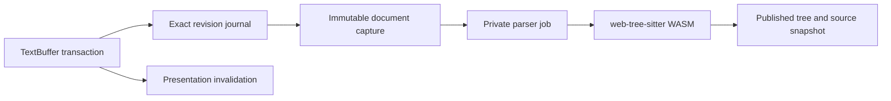

# Text snapshots and web-tree-sitter

The JavaScript document model remains authoritative. `TreeSitterDocument` captures its immutable text root and exact applied-change journal; `TreeSitterParser` owns private editable trees and resumable WASM parser jobs. Published trees retain their own source snapshot, so nodes held by a consumer keep referring to the correct revision after the buffer changes.

## Coordinates and input

The installed binding is web-tree-sitter 0.27.1. Its [WASM adapter](https://github.com/tree-sitter/tree-sitter/blob/v0.27.1/lib/binding_web/lib/tree-sitter.c) converts JavaScript code-unit offsets and columns to byte offsets and parses UTF-16LE. Lumine therefore supplies its existing UTF-16 coordinates directly; it must not add a separate UTF-8 conversion merely because the native Tree-sitter API names its fields in bytes. CRLF handling and surrogate pairs are covered by differential syntax tests.

Parser input comes from a snapshot reader in 4096-unit chunks. Node text uses a separate 32768-unit reader. Parsing does not call the legacy whole-input materialization getter; an explicit consumer request for `tree.input` still produces a string. The binding's parse-input buffer is bounded, so increasing callback chunks arbitrarily is not a free optimization.

The journal already includes `startIndex`, `oldEndIndex`, `newEndIndex` and corresponding positions. Invalidation uses those fields without reading old/new text payloads. Incremental preparation no longer traverses inserted text to rediscover an end position that the journal already supplied. Synthetic fragment-compaction edits retain their known coordinates too, avoiding replay of earlier document edits solely to reconstruct those positions. Callers without coordinates retain the general replay path.

## Independent batches

Large independent batches preserve two different responsibilities. `onDidApplyChanges` still carries every exact splice in application order for parser revision tracking and other consumers. Presentation, fold and injection invalidation can use one conservative affected extent after the marker indexes have applied all splices.

The language mode opts into this through `canBatchTextChanges` and `bufferDidChangeBatch`; TextBuffer does not choose parser policy. The current threshold is owned by `TreeSitterParser.bulkEditLimit`, matching the existing 128-edit fresh-parse threshold. Smaller transactions keep granular invalidation. This threshold was not retuned in this pass; sparse edits in very large files are a separate candidate for measuring incremental-versus-fresh parse policy.

The combined invalidation receives exact old/new extents and offsets, never substitutes a coarse edit into the public document journal, and preserves the original transaction change count. Ranges and injection boundaries are re-derived conservatively where needed. Comparing only root node types is insufficient: regression tests compare every node's type, indices and row/column positions across all language layers against a fresh parse, then repeat after undo and redo.

## Lifetime and cancellation

The [upstream tree wrapper](https://github.com/tree-sitter/tree-sitter/blob/v0.27.1/lib/binding_web/src/tree.ts) owns its WASM allocation through explicit deletion and finalization. Lumine explicitly deletes private working copies and closes parser jobs on destruction; published snapshots follow their consumers' lifetimes. Published trees reject in-place edits. Existing cursor ownership protection remains in place.

The [parser interface](https://github.com/tree-sitter/tree-sitter/blob/v0.27.1/lib/binding_web/src/parser.ts) supports progress callbacks and included ranges. Lumine continues parsing in budgeted slices, discards obsolete work, and retains its changed-included-range resume guard for this runtime version. This pass does not replace web-tree-sitter, mutate a published tree, or add a mirrored worker document.

The upstream sources above were reviewed at tag `v0.27.1` on 2026-10-19 alongside the installed implementation. No upstream implementation was copied into the changes.
