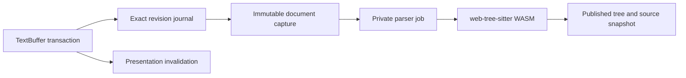

# Text snapshots and web-tree-sitter

The JavaScript document model remains authoritative. `TreeSitterDocument` captures its immutable text root and exact applied-change journal; `TreeSitterParser` owns private editable trees and resumable WASM parser jobs. Published trees retain their own source snapshot, so nodes held by a consumer keep referring to the correct revision after the buffer changes.

## Coordinates and input

The installed binding is web-tree-sitter 0.27.1. Its [WASM adapter](https://github.com/tree-sitter/tree-sitter/blob/v0.27.1/lib/binding_web/lib/tree-sitter.c) converts JavaScript code-unit offsets and columns to byte offsets and parses UTF-16LE. Lumine therefore supplies its existing UTF-16 coordinates directly; it must not add a separate UTF-8 conversion merely because the native Tree-sitter API names its fields in bytes. CRLF handling and surrogate pairs are covered by differential syntax tests.

Parser input comes from a snapshot reader in 4096-unit chunks. Node text uses a separate 32768-unit reader. Parsing does not call the legacy whole-input materialization getter; an explicit consumer request for `tree.input` still produces a string. The binding's parse-input buffer is bounded, so increasing callback chunks arbitrarily is not a free optimization.

The journal already includes `startIndex`, `oldEndIndex`, `newEndIndex` and corresponding positions. Invalidation uses those fields without reading old/new text payloads. Incremental preparation no longer traverses inserted text to rediscover an end position that the journal already supplied. Synthetic fragment-compaction edits retain their known coordinates too, avoiding replay of earlier document edits solely to reconstruct those positions. Callers without coordinates retain the general replay path.

## Independent batches

Large independent batches preserve two different responsibilities. `onDidApplyChanges` still carries every exact splice in application order for parser revision tracking and other consumers. Presentation, fold and injection invalidation can use one conservative affected extent after the marker indexes have applied all splices.

The language mode opts into this through `canBatchTextChanges` and `bufferDidChangeBatch`; TextBuffer does not choose parser policy. The current threshold is owned by `TreeSitterParser.bulkEditLimit`, matching the existing 128-edit fresh-parse threshold. Smaller transactions keep granular invalidation. This threshold was not retuned in this pass; sparse edits in very large files are a separate candidate for measuring incremental-versus-fresh parse policy.

The combined invalidation receives exact old/new extents and offsets, never substitutes a coarse edit into the public document journal, and preserves the original transaction change count. Ranges and injection boundaries are re-derived conservatively where needed. Comparing only root node types is insufficient: regression tests compare every node's type, indices and row/column positions across all language layers against a fresh parse, then repeat after undo and redo.

## Lifetime and cancellation

The [upstream tree wrapper](https://github.com/tree-sitter/tree-sitter/blob/v0.27.1/lib/binding_web/src/tree.ts) owns its WASM allocation through explicit deletion and finalization. Lumine explicitly deletes private working copies and closes parser jobs on destruction; published snapshots follow their consumers' lifetimes. Published trees reject in-place edits. Existing cursor ownership protection remains in place.

Published trees have a managed owner. Nodes and cursors retain that owner, so collection cannot invalidate a consumer's older snapshot. Once the owner is collected, the raw tree enters a disposal queue instead of running its WASM destructor inside V8's finalizer batch. The queue prefers 100 ms without text edits and yields between jobs with a 2 ms target. Above 2048 pending jobs it makes progress even during continuous editing. These are scheduling targets, not hard latency or byte limits: a single native destructor cannot be interrupted and may exceed the target. Retired queue slots are compacted under sustained pressure. No dependency source or WASM memory layout is modified.

Ready small buffers and fast large grammars update synchronously. For buffers of at least 512 Ki UTF-16 units, two consecutive foreground syntax updates exceeding 12 ms switch that mode to resumable asynchronous updates. A single cold call does not change policy. The mode remains eligible for synchronous work after shrinking below the size threshold; reopening or replacing the grammar starts a new observation period. During pending work, presentation reuses shifted cached scopes, while semantic consumers await `editor.whenGrammarSettled()` for current syntax and requested indentation. This avoids charging every key for a slow grammar's complete incremental parse, but does not make query compilation or changed-range comparison interruptible.

Once a large root has switched to asynchronous updates, consecutive edits less than 50 ms apart wait for a 50 ms quiet period before capturing input or acquiring a parser. Cancellation removes that wait, and a revision check prevents submitted ranges from being paired with newer text. The first edit after a pause starts immediately; cold loads, injection parses, small buffers and fast synchronous grammars do not use this delay. This avoids repeatedly starting work that the next key would cancel, at the cost of deferring fresh syntax until the burst pauses. The quiet period is not a bound on the subsequent parse or publication time.

The [parser interface](https://github.com/tree-sitter/tree-sitter/blob/v0.27.1/lib/binding_web/src/parser.ts) supports progress callbacks and included ranges. Lumine continues parsing in budgeted slices, discards obsolete work, and retains its changed-included-range resume guard for this runtime version. This pass does not replace web-tree-sitter, mutate a published tree, or add a mirrored worker document.

The upstream sources above were reviewed at tag `v0.27.1` on 2026-10-19 alongside the installed implementation. No upstream implementation was copied into the changes.

## Indentation plans

Indentation hinting and explicit reindent serve different purposes. A new line needs a suggestion from its surrounding text, including incomplete syntax. Reindent of an existing Python document must preserve the parsed block structure: a following top-level function must not become nested merely because the preceding row was inside another function. Paste keeps relative indentation instead of independently reformatting every copied line.

An ordinary indentation hint is an absolute level. With `preserveLeadingWhitespace`, it is an amount to prepend. Batch planning keeps these returned values separate from the absolute levels used by comparison rows and `@match` references. It accounts for tab stops after prepending whitespace and honors blank-line comparison policy. Blank-row baselines for multicursor Enter are captured before insertion observers can trim the old rows. LF and CRLF insertion use the same indentation policy.

The planner reuses a syntax snapshot per controlling layer, including when the comparison and target rows belong to different injection layers. Each query uses its own layer's scope resolver. A predicate that does not match skips that capture, not all remaining dedent rules. Query results are planned against one buffer revision; changes during planning or while awaiting syntax invalidate the request. Missing and nonfinite hints never mean zero indentation.

A batch map contains numeric hints, explicit `null` values for rows whose whitespace must be retained byte for byte, and omitted rows for which the caller may try a fallback. A `null` map declines the whole plan. Applying a plan skips unchanged rows, reuses indentation strings and submits leading-whitespace replacements through `setTextInIndependentRanges`; large plans update display geometry once. The editor's normal soft-tab and tab-length settings still determine inserted whitespace.

Queries can use `(#is? indent.reindent true)` to restrict captures to explicit batch reindent, excluding typing, Enter and relative paste adjustment. `@preserve` retains a row without normalizing its tabs into spaces. Python uses these mechanisms for parsed module/block boundaries, clauses, multiline string contents and comments. Its structural queries are rooted at local captures and inspect `test.typeAt "parent …"`; `test.typeAt "self …"` checks the captured node's type without reading its text. These hints preserve available syntax structure rather than inferring intended scopes from arbitrarily malformed indentation.

Deferred paste adjustment owns a marker for each individual pasted range, waits for syntax, checks the current buffer and revision, groups its correction with the paste and releases all temporary markers on success, cancellation or failure. It does not substitute the transaction's combined range for each insertion. Async paste returns a tracked promise so `whenGrammarSettled()` includes the correction.

Deferred single-row indentation requests also register a transaction-level correction. A rapid newline burst may supersede every individual revision-bound hint; the final correction plans the affected rows together against current syntax. Its whitespace edits remain grouped with the insertion, and an intervening undo cancels obsolete work.
